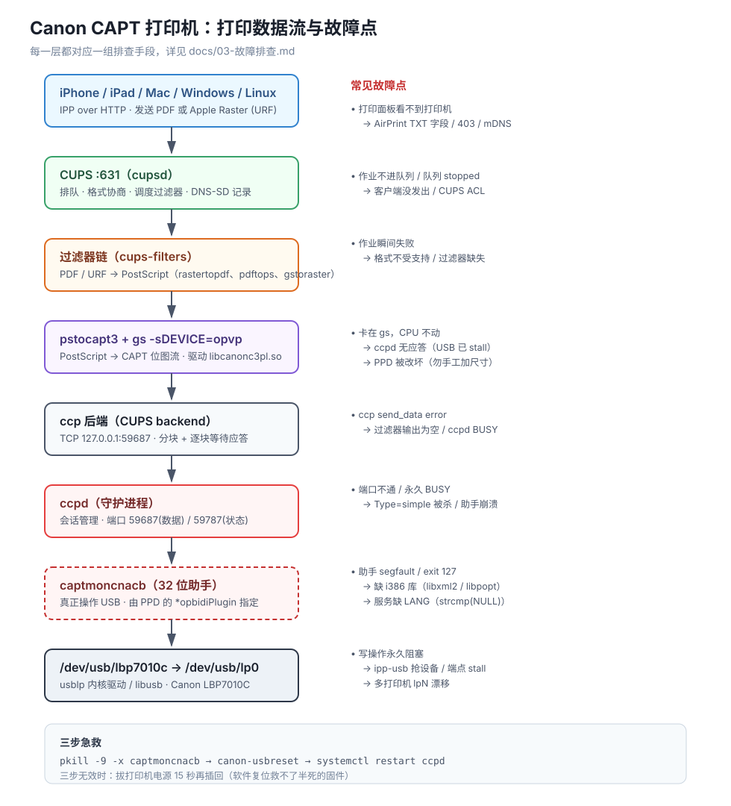

<div align="center">

**English** · [简体中文](README.md)

# 🖨️ Canon CAPT Printer → Network Printer + AirPrint on Linux

**Turn a USB-only Canon laser printer into a wireless printer the whole household can use**

[](https://www.debian.org/)
[](https://openprinting.github.io/cups/)
[](#-quick-start)
[](LICENSE)
[](CONTRIBUTING.md)

Print from your iPhone in two taps — no PC, no vendor app.

</div>

---

## 😩 Sound familiar?

| Problem | Reality |
|---|---|
| The printer only has USB, no Ethernet | You have to walk over and plug in a cable every time |
| Documents pile up on your phone | The iPhone print sheet shows **zero printers** |
| You tried installing the Canon driver on Linux/NAS | The queue looks fine, jobs sit in "Printing" forever |
| Every online tutorial is a different half-answer | It installs… and not a single page comes out |

Canon's **CAPT** family (LBP2900 / 3000 / 5100 / 6300 / 7010C / 7018C …) are *host-based* printers:
all rendering happens in the Windows driver, so on Linux you must use Canon's proprietary CAPT driver —
and that driver has a pile of traps that only work under very specific conditions.

## ✨ What this project does

```
Before: printer → USB → one Windows PC → only that PC can print
After:  printer → USB → NAS/Linux → LAN + AirPrint → phones, tablets, laptops
```

<div align="center">

</div>

**Verified**: iPhone (iOS 15 / iOS 26), macOS, Windows and Linux all work; A4/A5/B5 available.

---

## 🚀 Quick start

> About 10 minutes. You only need to copy-paste a few commands.
> **Requirements**: Linux host (Debian 12 / fnOS / Ubuntu), printer connected by USB to that host, root access.

### Step 1 · Clone

```bash
git clone https://github.com/<your-user>/canon-capt-airprint.git
cd canon-capt-airprint
```

### Step 2 · Edit three variables

Open `canon-capt-airprint-setup.sh` and adjust the header:

```bash
QUEUE="LBP7010C"                    # queue name (any name, model recommended)
USB_PID="271c"                      # USB PID — check with lsusb
PPD_NAME="CNCUPSLBP7010CCAPTJ.ppd"  # PPD inside the driver package (see table below)
```

Not sure about the PID? Plug the printer in and run `lsusb | grep -i canon`.
You'll see something like `ID 04a9:271c` — the last four characters are the PID.

### Step 3 · Run

```bash
sudo bash canon-capt-airprint-setup.sh
```

The script handles everything: driver install → 32-bit runtime libs → udev → CUPS → queue → `ccpd` → AirPrint advertisement → self-test.

When you see `通过 N 项 / 失败 0 项` (N checks passed, 0 failed), go print from your phone 📱

<details>
<summary><b>👉 How to add the printer on each device</b></summary>

**iPhone / iPad** — Photos or Files → Share → Print → choose `Canon LBP7010C (hostname)`

**macOS** — System Settings → Printers & Scanners → `+` → **IP** → address = NAS IP,
protocol `IPP`, queue = `LBP7010C`, driver = **Generic PostScript Printer**

**Windows** — Settings → Printers → Add → "The printer that I want isn't listed" →
Select by name → `http://<NAS-IP>:631/printers/LBP7010C` → driver **Microsoft PS Class Driver**

**Linux** — `lpadmin -p canon -E -v ipp://<NAS-IP>:631/printers/LBP7010C -m everywhere`

</details>

---

## ✅ Who this is for / ❌ who it isn't

| Good fit | Not a fit |
|---|---|
| ✅ Canon **CAPT** series laser printers (see table) | ❌ Canon **UFR II** models (official Linux driver exists) |
| ✅ Sharing a USB printer over the network | ❌ Network printers with AirPrint (just use `driverless`) |
| ✅ fnOS / Debian / Ubuntu on x86_64 | ❌ ARM boards (Raspberry Pi etc.) — CAPT ships x86 binaries only |
| ✅ You can spend 10 minutes following commands | ❌ You need zero-configuration, zero-touch setup |

---

## 📦 Supported models

All PPDs ship inside the same driver package — just change `PPD_NAME`:

| Model | PPD file |
|---|---|
| **LBP7010C** | `CNCUPSLBP7010CCAPTJ.ppd` |
| LBP7018C | `CNCUPSLBP7018CCAPTK.ppd` |
| LBP2900 | `CNCUPSLBP2900CAPTK.ppd` |
| LBP3000 | `CNCUPSLBP3000CAPTK.ppd` |
| LBP5100 | `CNCUPSLBP5100CAPTK.ppd` |
| LBP6300 | `CNCUPSLBP6300CAPTK.ppd` |

> After installing the driver: `ls /usr/share/cups/model/ | grep CNCUPS` lists everything.
> Other models may work too — as long as the USB PID and PPD match.

---

## 🧭 Why other tutorials fail

Every link in this chain reports the same useless symptom: **"the printer does nothing."**
Here is what is actually going on:

| 😵 What you see | 🔍 The real cause |
|---|---|
| `ccpd` restarts forever, counter in the hundreds | Unit written as `Type=simple`; the forked daemon is killed by the cgroup |
| `bidiNew() Error!` | The 64-bit package ships a **32-bit** helper; missing `libxml2:i386` |
| `captmoncnacb ... segfault at 0` | `ccpd` has no **locale**; message table lookup returns NULL → `strcmp(NULL)` |
| `usblp removed / usb reset` on repeat | `ipp-usb` grabs the USB interface away |
| Writes block forever | Multiple printers share `lp0/lp1`, numbering drifts on replug |
| CUPS returns **403** after a restart | `<Location>` ACL stops matching local clients |
| iOS 26 shows **no printer at all** | TXT has `URF=none`, unexpanded `%h` in `adminurl`, wrong `pdl` order |
| iOS paper list only has Letter/Legal | `ReadyPaperSizes` defaults to the US set (and **must not be quoted**) |
| Everything hangs after adding A6 to the PPD | It breaks `gs -sDEVICE=opvp` parameter parsing |

Full analysis 👉 [Troubleshooting (Chinese)](docs/03-故障排查.md)

---

## 📚 Documentation

> Docs are currently written in **Chinese**. English translations are welcome — see [CONTRIBUTING.md](CONTRIBUTING.md).

| | Doc | Contents |
|---|---|---|
| 🧠 | [01 · Architecture](docs/01-原理与架构.md) | Data path, component responsibilities, pre-flight checks |
| 🔧 | [02 · Deployment](docs/02-部署步骤.md) | 10-step manual deployment (if you want to understand every step) |
| 🚑 | [03 · Troubleshooting](docs/03-故障排查.md) | 7-step triage, 12-symptom table, three-step rescue |
| ✅ | [04 · Verification & Ops](docs/04-验收与运维.md) | Acceptance checklist, logs, upgrade notes, rollback |
| 📎 | [05 · Appendix](docs/05-附录.md) | File map, CAPT protocol cheat sheet, packet-capture guide |

---

## ❓ FAQ

<details>
<summary><b>The job is stuck in "Printing" forever — what now?</b></summary>

Run these three commands first (fixes ~90% of cases):

```bash
sudo pkill -9 -x captmoncnacb
sudo /usr/local/sbin/canon-usbreset
sudo systemctl restart ccpd
```

Still stuck? **Unplug the printer's power for 15 seconds**, plug it back in, then repeat the commands.

Why: after an interrupted CAPT transfer the USB endpoint stays stalled, and only a device-level
reset (or a power cycle) clears it.
</details>

<details>
<summary><b>iPhone can't see the printer at all</b></summary>

In order:

1. On the iPhone, open `http://<NAS-IP>:631/printers/<queue>` in Safari. If the CUPS page loads, networking is fine.
2. On the NAS: `avahi-browse -rt _ipp._tcp` — is your printer listed with a `URF=` field?
3. Capture what iOS actually sends:
   ```bash
   sudo tcpdump -i any -n 'udp port 5353 or tcp port 631'
   ```
   If there is **no `_ipp` query at all**, iOS filtered the printer during browsing →
   review the [AirPrint TXT fields](docs/02-部署步骤.md#48-发布-airprint).
</details>

<details>
<summary><b>The paper size list has no A4/A5/B5</b></summary>

iOS builds that list from the IPP `media-ready` attribute, and CUPS picks a default set by region.
Force it in `/etc/cups/cupsd.conf`:

```conf
DefaultPaperSize A4
ReadyPaperSizes A4,A5,B5,Legal
```

⚠️ **Do not quote the value**, and never hand-edit paper sizes into the PPD — both are verified traps.
</details>

<details>
<summary><b>Windows prints nothing after adding the printer</b></summary>

Windows' IPP client is flaky; sometimes the job never leaves the PC (CUPS receives nothing).
Check with:

```bash
sudo tcpdump -i any -n 'tcp port 631'
```

If the PC truly sends nothing, use a RAW 9100 relay instead, or print from macOS / iOS.
</details>

<details>
<summary><b>Is this a security risk?</b></summary>

The script sets CUPS access control to `Allow all` (typical for a home LAN), which means any device
on the same subnet can print. The admin pages still require authentication.
For an office network, restrict the ACL to your subnet as described in the deployment doc.
</details>

---

## 🧪 Tested environment

| Item | Version / model |
|---|---|
| Host OS | fnOS (Debian 12 bookworm), kernel `6.18.18`, `x86_64` |
| CUPS | `2.4.2-3+deb12u9` |
| Avahi | `0.8-10+deb12u1` |
| Ghostscript | `10.05.1` (must provide the `opvp` device) |
| Driver | Canon CAPT `2.71` (amd64 package + i386 runtime `libxml2` / `libpopt0`) |
| Printer | Canon i-SENSYS LBP7010C, USB `04a9:271c` |
| Clients verified | iPhone (iOS 15 / iOS 26), macOS, Windows 10/11, Linux CUPS |
| Scenarios verified | Single A4 page, multi-page jobs, first job after idle, recovery after reboot |

**Environment-sensitive** — read the version notes in the [appendix](docs/05-附录.md) before porting.

---

## 🗂️ Project structure

```
canon-capt-airprint/
├── canon-capt-airprint-setup.sh   # one-shot, idempotent deployment
├── docs/
│   ├── 01-原理与架构.md            # architecture (zh)
│   ├── 02-部署步骤.md              # deployment (zh)
│   ├── 03-故障排查.md              # troubleshooting (zh)
│   ├── 04-验收与运维.md            # verification & ops (zh)
│   ├── 05-附录.md                  # appendix (zh)
│   └── images/flow.svg            # architecture diagram (vector)
├── CONTRIBUTING.md
├── CHANGELOG.md
└── LICENSE
```

---

## 🤝 Contributing

Worked for you? Broke on your machine? Either way, please open an
[Issue](https://github.com/<owner>/canon-capt-airprint/issues) with your **model + distro + error**.
Every real-world report saves the next person hours of debugging.

- Read [CONTRIBUTING.md](CONTRIBUTING.md) before sending a PR
- If this saved you a few hours, **a ⭐ is the best way to say thanks**

---

## ⚠️ Disclaimer

This project only provides **configuration knowledge and scripts**. It contains no Canon binaries
or source code. Download the CAPT driver from Canon's official support pages and comply with its license.
Use at your own risk.

Trademarks and copyrights belong to their respective owners:
CUPS (Apache-2.0), Avahi (LGPL), Ghostscript (AGPL), Canon CAPT (proprietary).

## 📄 License

[MIT](LICENSE) © 2026
