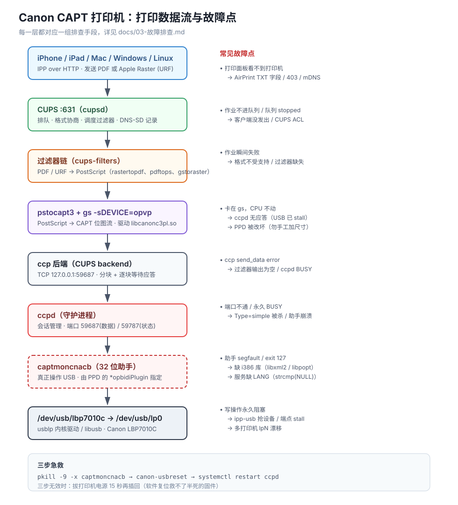

<div align="center">

**[简体中文](README.md)** · [English](README.en.md)

# 🖨️ Canon CAPT 打印机 → 网络打印 + AirPrint

**把一台只能插 USB 的老式佳能激光打印机，变成全家人都能用的无线打印机**

[](https://www.debian.org/)
[](https://openprinting.github.io/cups/)
[](#-三步上手)
[](LICENSE)
[](CONTRIBUTING.md)

iPhone 点一下就能打 · 不用开电脑 · 不用装厂商 App

</div>

---

## 😩 你大概率遇到过这些

| 痛点 | 现实 |
|---|---|
| 打印机只有 USB 口，没有网口 | 每次打印都要跑去插线 |
| 手机里存了一堆资料想打出来 | iPhone 打印面板里**一台打印机都没有** |
| 在 Linux / NAS 上装佳能驱动 | 装完队列是假的，作业永远“正在打印” |
| 网上教程东拼西凑 | 照着做能装完，但**一张纸都出不来** |

Canon 的 **CAPT** 系列（LBP2900 / 3000 / 5100 / 6300 / 7010C / 7018C …）是“主机型”打印机，
渲染全靠 Windows 驱动，Linux 上必须用 Canon 的闭源驱动——而这套驱动有一堆**只在特定版本组合下才不炸**的坑。

## ✨ 这个项目做了什么

```
之前：打印机 → USB → 一台 Windows 电脑 → 只有这台电脑能打
现在：打印机 → USB → NAS/Linux → 局域网 + AirPrint → 手机/平板/电脑都能打
```

<div align="center">

</div>

**实测结果**：iPhone（iOS 15 / iOS 26）、Mac、Windows、Linux 全部打通，A4/A5/B5 可选。

---

## 🚀 三步上手

> 全程约 10 分钟，只需要你会复制粘贴命令。
> **前提**：Linux 主机（Debian 12 / fnOS 等）、打印机 USB 直连这台机器、你有 root。

### 第 1 步 · 下载

```bash
git clone https://github.com/xiaobaisiji/canon-capt-airprint.git
cd canon-capt-airprint
```

### 第 2 步 · 改一行配置

打开 `canon-capt-airprint-setup.sh`，按你的机型改文件开头三个变量：

```bash
QUEUE="LBP7010C"                    # 队列名，随便起，建议用型号
USB_PID="271c"                      # 打印机的 USB PID（用 lsusb 查）
PPD_NAME="CNCUPSLBP7010CCAPTJ.ppd"  # 驱动包内对应 PPD，见下方对照表
```

不确定 PID？插上打印机执行 `lsusb | grep -i canon`，会看到类似 `ID 04a9:271c`，最后四位就是。

### 第 3 步 · 运行

```bash
sudo bash canon-capt-airprint-setup.sh
```

脚本会自动完成：装驱动 → 补 32 位运行库 → 配 udev → 配 CUPS → 建队列 → 起 `ccpd` → 发布 AirPrint → 自检。

看到最后的 `通过 N 项 / 失败 0 项`，就可以去手机上打印了 📱

<details>
<summary><b>👉 装完之后，各设备怎么加？（点开看）</b></summary>

**iPhone / iPad**：打开照片或文件 → 分享 → 打印 → 在打印机列表里选 `Canon LBP7010C (主机名)`

**Mac**：系统设置 → 打印机与扫描仪 → `+` → **IP** → 地址填 NAS 的 IP、协议 `IPP`、队列填 `LBP7010C`、驱动选 **通用 PostScript 打印机**

**Windows**：设置 → 打印机 → 添加设备 → 我需要的打印机不在列表中 → 按名称 → `http://<NAS-IP>:631/printers/LBP7010C` → 驱动选 **Microsoft PS Class Driver**

**Linux**：`lpadmin -p canon -E -v ipp://<NAS-IP>:631/printers/LBP7010C -m everywhere`

</details>

---

## ✅ 适合谁 / ❌ 不适合谁

| 适合 | 不适合 |
|---|---|
| ✅ Canon **CAPT** 系列激光打印机（见下方型号表） | ❌ Canon **UFR II** 机型（有官方 Linux 驱动，不需要本项目） |
| ✅ 想把 USB 打印机变成网络共享 | ❌ 支持 AirPrint 的网络机型（插网线直接 `driverless` 即可） |
| ✅ fnOS / Debian / Ubuntu 等 x86_64 系统 | ❌ ARM 设备（树莓派等）：CAPT 只有 x86 构建 |
| ✅ 愿意花 10 分钟跟着命令走 | ❌ 希望“一键无脑、不改任何配置”的复杂环境 |

---

## 📦 支持的机型

同一个驱动包内自带各机型 PPD，改 `PPD_NAME` 即可：

| 机型 | PPD 文件名 |
|---|---|
| **LBP7010C** | `CNCUPSLBP7010CCAPTJ.ppd` |
| LBP7018C | `CNCUPSLBP7018CCAPTK.ppd` |
| LBP2900 | `CNCUPSLBP2900CAPTK.ppd` |
| LBP3000 | `CNCUPSLBP3000CAPTK.ppd` |
| LBP5100 | `CNCUPSLBP5100CAPTK.ppd` |
| LBP6300 | `CNCUPSLBP6300CAPTK.ppd` |

> 装完驱动后 `ls /usr/share/cups/model/ | grep CNCUPS` 可看完整列表。
> 没在表里的机型也可以试——只要 USB PID 和 PPD 对得上。

---

## 🧭 为什么照着别的教程做不出来？

因为这个链条上**任何一环错了，表现都是同一句话：“打印机没反应”**。本项目把每一环的根因都挖出来了：

| 😵 你会看到 | 🔍 真正的原因 |
|---|---|
| `ccpd` 反复重启，计数器涨到几百 | systemd 单元写成 `Type=simple`，fork 出的守护进程被 cgroup 杀掉 |
| `bidiNew() Error!` | 64 位驱动包内部的助手是 **32 位**，缺 `libxml2:i386` |
| `captmoncnacb ... segfault at 0` | `ccpd` 服务缺 **locale**，消息表查不到 → `strcmp(NULL)` |
| `usblp removed / usb reset` 反复刷屏 | `ipp-usb` 抢走了 USB 接口 |
| 数据写进去就永久阻塞 | 多台打印机共用 `lp0/lp1`，编号随插拔漂移 |
| CUPS 重启后 TCP 631 全部 **403** | `<Location>` 的 `@Local` 判定失效 |
| iOS 26 打印面板**一台都看不到** | TXT 里 `URF=none`、`adminurl` 的 `%h` 没替换、`pdl` 顺序不对 |
| iOS 纸张列表只有 Letter/Legal | `ReadyPaperSizes` 走了美制分支（且**不能加引号**） |
| 手工往 PPD 加 A6 后全部卡死 | 破坏了 `gs -sDEVICE=opvp` 的参数解析 |

完整分析见 👉 [03 · 故障排查](docs/03-故障排查.md)

---

## 📚 文档

| | 文档 | 里面有什么 |
|---|---|---|
| 🧠 | [01 · 原理与架构](docs/01-原理与架构.md) | 数据流图、每个组件负责什么、部署前自检清单 |
| 🔧 | [02 · 部署步骤](docs/02-部署步骤.md) | 10 步手动部署（想理解每一步在干嘛就看这个） |
| 🚑 | [03 · 故障排查](docs/03-故障排查.md) | **7 步定位法** + 12 条症状对照表 + 急救三步 |
| ✅ | [04 · 验收与运维](docs/04-验收与运维.md) | 验收清单、日志在哪、升级注意、完整回滚 |
| 📎 | [05 · 附录](docs/05-附录.md) | 文件清单、CAPT 协议速查、AirPrint 抓包判读 |

---

## ❓ 常见问题

<details>
<summary><b>打印机卡住了，作业一直“正在打印”怎么办？</b></summary>

先跑这三步（解决 90% 的情况）：

```bash
sudo pkill -9 -x captmoncnacb
sudo /usr/local/sbin/canon-usbreset
sudo systemctl restart ccpd
```

还不行就**把打印机电源拔掉，等 15 秒再插回**，然后重复上面三步。
原因：CAPT 驱动中断后 USB 端点会停在 stall 状态，软件复位救不了半死的固件。
</details>

<details>
<summary><b>iPhone 打印面板里看不到打印机？</b></summary>

按顺序排查：

1. 在 iPhone 的 Safari 里打开 `http://<NAS-IP>:631/printers/<队列>`，能打开说明网络没问题
2. 检查 `avahi-browse -rt _ipp._tcp` 有没有你的打印机
3. 在 NAS 上抓包确认 iOS 到底有没有发起查询：
   ```bash
   sudo tcpdump -i any -n 'udp port 5353 or tcp port 631'
   ```
   如果完全没有 `_ipp` 查询，说明 iOS 在浏览阶段就过滤掉了 → 回去看 [AirPrint TXT 字段](docs/02-部署步骤.md#48-发布-airprint)
</details>

<details>
<summary><b>iOS 纸张列表里没有 A4/A5/B5？</b></summary>

iOS 的纸张列表来自 IPP 的 `media-ready`，CUPS 默认按地区给美制或公制。在 `/etc/cups/cupsd.conf` 里加：

```conf
DefaultPaperSize A4
ReadyPaperSizes A4,A5,B5,Legal
```

⚠️ **不要加引号**，也不要往 PPD 里手工加尺寸——这两点都是实测踩出来的坑。
</details>

<details>
<summary><b>Windows 添加了但打印没反应？</b></summary>

Windows 的 IPP 客户端不太稳定，实测会出现“CUPS 侧收不到任何报文”的情况。排查：

```bash
sudo tcpdump -i any -n 'tcp port 631'   # 抓一下 Windows 到底发没发
```

如果确实没发，可以改用 RAW 9100 中转（脚本 `setup-win9100.sh` 的思路），或者直接用 Mac / iPhone 打印。
</details>

<details>
<summary><b>会不会有安全风险？</b></summary>

脚本把 CUPS 的访问控制设为 `Allow all`（家庭内网常见做法），意味着**同网段设备都能打印**。
管理页面仍需认证。如果你在办公网等环境，请把 `docs/02-部署步骤.md` 里的 ACL 改成指定网段。
</details>

---

## 🧪 测试环境

| 项目 | 版本 / 型号 |
|---|---|
| 主机系统 | fnOS（Debian 12 bookworm），内核 `6.18.18`，`x86_64` |
| CUPS | `2.4.2-3+deb12u9` |
| Avahi | `0.8-10+deb12u1` |
| Ghostscript | `10.05.1`（需带 `opvp` 设备） |
| 打印驱动 | Canon CAPT `2.71`（amd64 包 + i386 运行库 `libxml2` / `libpopt0`） |
| 打印机 | Canon i-SENSYS LBP7010C，USB `04a9:271c` |
| 已验证客户端 | iPhone（iOS 15 / iOS 26）、macOS、Windows 10/11、Linux |
| 验证内容 | A4 单页、连续多页、空闲后首单、重启后自动恢复 |

**环境强相关**，换环境前请先看 [05 · 附录](docs/05-附录.md) 里的版本说明。

---

## 🗂️ 项目结构

```
canon-capt-airprint/
├── canon-capt-airprint-setup.sh   # 一键部署（幂等，可重复执行）
├── docs/
│   ├── 01-原理与架构.md
│   ├── 02-部署步骤.md
│   ├── 03-故障排查.md
│   ├── 04-验收与运维.md
│   ├── 05-附录.md
│   └── images/flow.svg            # 架构图（矢量）
├── CONTRIBUTING.md
├── CHANGELOG.md
└── LICENSE
```

---

## 🤝 贡献

装成功了？装失败了？都欢迎开 [Issue](https://github.com/xiaobaisiji/canon-capt-airprint/issues) 告诉我们你的**机型 + 发行版 + 报错**，
每一条真实案例都会让下一个人的排障时间少一点。

- 提交代码前请看一下 [CONTRIBUTING.md](CONTRIBUTING.md)
- 如果这个项目帮你省下了几个小时，**点个 ⭐ 就是最好的支持**

---

## ⚠️ 免责声明

本项目仅提供**配置经验与脚本**，不包含 Canon 的任何二进制或源码。
CAPT 驱动请自行从 Canon 官方支持页面下载，使用须遵守其许可协议。
按本文操作造成的任何后果由使用者自行承担。

组件版权归各自所有者：CUPS（Apache-2.0）、Avahi（LGPL）、Ghostscript（AGPL）、Canon CAPT（Canon 专有）。

## 📄 License

[MIT](LICENSE) © 2026
