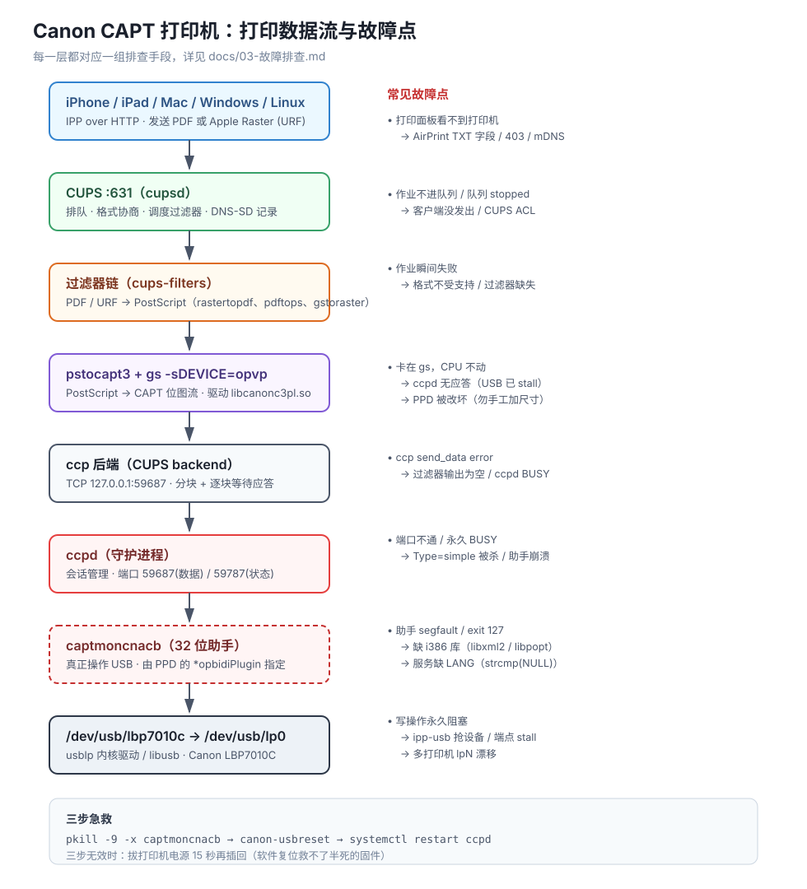

# 原理与架构

> 搞清 CAPT 打印机的数据流，才知道排障该看哪一环

[← 返回目录](../README.md)

---

## 1. 适用场景与前提

**适用**：Canon 的 **CAPT 主机型**激光打印机（LBP 系列：2900/3000/3010/3100/3300/5000/5100/5300/6018/6200/6300/7010C/7018C/7200C 等）。这类机器**没有 PCL/PS 解释器**，所有渲染都由 PC 上的驱动完成，因此 Linux 上必须用 Canon 的闭源 CAPT 驱动（filter + 守护进程）。

**不适用**：
- Canon 的 **UFR II** 机型（有官方 Linux 驱动，装 `cndrvcups-ufr2` 即可，不需要本教程）
- 支持 **IPP Everywhere / AirPrint** 的网络机型（插网线后 CUPS 直接 `driverless` 即可）
- **ARM** 平台：CAPT 2.71 只提供 i386 / x86_64 构建

**前提**：

| 项 | 要求 |
|---|---|
| 架构 | x86_64 |
| 发行版 | Debian 12 / Ubuntu 22.04 类（本教程在 fnOS 上验证） |
| 已有组件 | CUPS 2.4+、Avahi、ghostscript、systemd |
| 网络 | 打印机 USB 直连 NAS，NAS 与客户端同网段 |
| 权限 | root |

---

---

## 2. 原理：数据是怎么流到打印机的

```
iPhone / Mac / Win / Linux
        │  IPP (PDF 或 URF)
        ▼
   CUPS :631  ──► 过滤器链
                    │
                    ├─ PDF/URF ──(rastertopdf/gs)──► PostScript
                    │
                    └─ pstocapt3 ──(exec)──► gs -sDEVICE=opvp
                                              -sDriver=libcanonc3pl.so
                                              -sModel=LBP7010C
                                                 │  (OEF 驱动)
                                                 ▼
                                            CAPT 数据流
                                                 │ stdout
                                                 ▼
                                       ccp 后端 (CUPS backend)
                                                 │ TCP 127.0.0.1:59687
                                                 ▼
                                              ccpd 守护进程
                                                 │ fork + 管道
                                                 ▼
                                        captmoncnacb (32 位助手)
                                                 │ libusb / usblp
                                                 ▼
                                            /dev/usb/lp0 ──► 打印机
```

各组件职责（排障时按这个顺序定位）：

| 组件 | 职责 | 出问题时的典型现象 |
|---|---|---|
| CUPS | 排队、格式协商、调度过滤器 | 队列 stopped / 403 / 作业不出现 |
| pstocapt3 | 解析 PPD 与作业参数，拼 gs 命令行 | `can't make parameter` |
| gs + opvp | 把 PS 转成 CAPT 位图流 | 卡住不返回（要等 ccpd 应答） |
| ccpd | 管理打印机会话、转发 CAPT 数据 | 端口不通 / 永久 BUSY |
| captmoncnacb | **真正操作 USB 的 32 位助手** | segfault / 缺库退出 127 |
| usblp / libusb | 内核 USB 打印协议 | 端点 stall、设备反复重连 |

---


